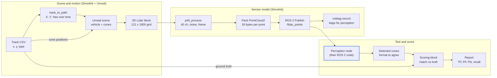

# SUFST Driverless Simulation – Work Summary

As of 16 Nov 2026 · Satay (Simulation & Validation)

## Purpose

The simulation & validation sub-team is building a simulator that lets the perception team test their LiDAR cone detection before the car runs, and scores how well it works.

- **Competition target:** FSG 2027 Driverless Cup (FSUK as a possible fallback).
- **Sensor:** the car uses one Hesai Pandar40P LiDAR and no camera, so perception is LiDAR-only.
- **What the simulator gives perception:** a 3D camera view of the track for humans to watch, a Pandar40P-like point cloud on ROS 2, and a score for their detections (e.g. 30/45 cones detected, precision, recall, position error).
- **How perception plugs in:** their algorithm stays an ordinary ROS 2 node. It subscribes to the same topic as on the real car and publishes detected cones back, so the same code runs in sim and on the car.
- **Other users later:** localisation, planning and control can drive the car in the same sim once the perception loop is working.

## Architecture

The simulator runs in MATLAB + Simulink with Unreal Engine 5; the perception algorithm connects only through ROS 2 topics.

One track CSV feeds the scene, the driving path and the ground truth. The point cloud goes out on `/lidar_points` live or as recorded bags, and detections come back for scoring. Only the perception node runs outside Simulink.

## What has been built so far

Layer 1 of the Simulink model runs, and the code for the sensor model, ROS 2 output, track library and driving path is written but not yet tested end to end.

| Part | Where | State |
| --- | --- | --- |
| Simulink Layer 1: scene, vehicle, LiDAR, camera, viewers | Simulink model | Runs without errors; car moved by a Ramp on X |
| Pandar40P parameter file (struct `P40`) | `pandar40p_params.m` | Written; block fields set to `P40.*` variables |
| LiDAR post-processing: 40-channel selection, range noise, dropout, range limits, frame change | `p40_process.m` (MATLAB Function block) | Written, not run |
| ROS 2 output: pack scan into `sensor_msgs/PointCloud2` | `p40_pack_pointcloud2.m` (MATLAB Function block) | Written, not run |
| Track library: acceleration, skidpad, 3 autocross, 1 trackdrive, with distractors | `generate_fs_tracks.m` → `tracks/*.csv` + `*_meta.mat` | Written by teammate |
| Constant-speed driving path along the track centre | `track_to_path.m` | Written, not run |
| FSDS track import | Python export via the FSDS client | Idea only; worth an afternoon at most |

## Pandar40P sensor model

The Simulation 3D Lidar block is set to a 1/3° grid from −25° to +15°, and post-processing keeps only the 40 rows that match the real Pandar40P channels. Values come from the Pandar40P user manual (v402, April 2025).

| Property | Real Pandar40P | Simulation setting |
| --- | --- | --- |
| Horizontal FOV / resolution | 360°, 0.2° at 10 Hz | `P40.hFov` = 360, `P40.hRes` = 0.2 |
| Frame rate | 10 Hz (20 Hz option) | Sample time `P40.Ts` = 0.1 s |
| Vertical FOV | −25° to +15° | Asymmetric limits −25 / +15 |
| Channels | 40, uneven; 0.33° spacing from +2° to −6° | 121-row grid at 1/3°, keep `P40.rowIdx` (40 rows) |
| Range | 0.3 to 200 m | Clipped in `p40_process` |
| Range accuracy / resolution | ±2 cm; 4 mm step | σ = 1 cm noise (assumed); `P40.rangeRes` = 0.004 |
| Points per scan | 72,000 (1800 × 40) | 1800 columns × 40 channels |
| Intensity | 0–255 | Reflectivity output scaled to 0–255 |
| Dropout | not specified | 2% random (assumed) |

- **Frame:** Simulink uses ISO 8855 (X forward, Y left). The Hesai frame has Y forward and X right, so points are converted with x_h = −y, y_h = x, z_h = z.
- **Message layout:** x, y, z, intensity (float32) + ring (uint16), 18 bytes per point, frame `hesai_lidar`, topic `/lidar_points`. Must be checked against the real HesaiLidar_ROS_2.0 driver output.
- **Left out for now:** motion distortion during the 0.1 s sweep, and dual return.

## Track library and driving path

Every track is defined once in a CSV, and both the Unreal scene and the scoring ground truth must come from that same file.

**Track library (`generate_fs_tracks.m`)** follows the FS Driverless Specification track marking: blue left, yellow right, small orange for lanes and stop areas, big orange at start, finish and timekeeping lines, at most 5 m between cones, and a minimum width of 3 m.

| Track | Event | Laps | Notes |
| --- | --- | --- | --- |
| `acceleration` | Acceleration | 1 | 75 m run + 75 m stop area |
| `skidpad` | Skidpad | 4 circles | Right circle ×2, then left ×2 |
| `autocross_01` to `_03` | Autocross | 1 | Three closed layouts, tighter cone spacing in corners |
| `trackdrive_01` | Trackdrive | 10 | Same layout as `autocross_01` |

Each track also has spare cone stacks and timekeeping equipment beside it, so the scoring can catch false positives. Dimensions marked CHECK in the script still need verifying against FS Rules chapter D.

**Driving path (`track_to_path.m`)** drives the car along `meta.centre` at a constant speed (default 10 m/s). Acceleration and skidpad run the centre path as generated; autocross and trackdrive start at `meta.startPose`, run `nLaps` laps, then 10 m past the line. It outputs `path.X`, `path.Y`, `path.Yaw` for three From Workspace blocks and `path.tEnd` for the stop time.

- Run each track at about 5, 10 and 15 m/s, so speed-related effects show up in the results.
- Keep skidpad near 8 m/s; 12 m/s would mean about 1.6 g, which a real FS car cannot do.

## Key decisions and why

| Decision | Why |
| --- | --- |
| Simulator moved from EUFS Sim2 (Gazebo) to MATLAB + Simulink + Unreal Engine (Nov 2026) | Other sub-teams test their work in it; Unreal gives a camera view and a ray-cast LiDAR from the same scene |
| Perception algorithm stays a separate ROS 2 node | Same code runs in sim and on the car; it reads `/lidar_points` either way |
| Match the real Hesai driver's topic, frame and field layout | So nothing changes when the team moves from sim to car |
| One CSV per track feeds both the scene and the ground truth | Scene and truth cannot drift apart, so scores stay trustworthy |
| Constant speed along the centreline | Repeatable runs, comparable across tracks; the vehicle block is kinematic |
| Hand perception recorded rosbags, not a video export | Perception only reads the point cloud; bags let them test without MATLAB, Unreal or a strong GPU |
| Use FSDS for track layouts only, not its Unreal map | FSDS is Unreal Engine 4 with AirSim cone actors; current MATLAB uses Unreal Engine 5, and the cones would not survive migration |
| Scoring counts only cones the LiDAR could see | 30/45 is fair only if all 45 were in range, in view and hit by enough points |

## Open issues and risks

The biggest open issue is getting cones from the CSV into the Unreal scene; it decides how fast new tracks can be added.

1. **Cones in the scene.** Placing them by hand in the Unreal Editor is slow and lets scene and truth drift apart. Options: an Unreal Engine 5 editor Python script that spawns cones from the CSV, or a Simulation 3D Actor block that spawns them at simulation start, if the install has it.
2. **Coordinate check.** Unreal's Y axis may be flipped relative to Simulink. On the acceleration track, blue cones must appear on the car's left; fix any mirroring before scoring.
3. **Yaw units.** `track_to_path` outputs degrees by default; confirm what the vehicle block expects.
4. **Row order of the LiDAR grid.** Confirm the top row is +15°; if not, switch to `P40.rowIdxBottomFirst`.
5. **Reflectivity range.** Check whether the block outputs 0–1 or 0–255, and whether cone materials give realistic intensity. Colour classification from intensity may be limited in sim.
6. **PointCloud2 size.** Array limits must be raised (data ≥ 1,296,000 bytes); use best-effort QoS for large messages.
7. **Timing.** Simulink time is not wall-clock; use Simulation Pacing or `/clock` with `use_sim_time`, and match detections to scans by header stamp.
8. **Hardware.** The laptop has an Intel Xe GPU and no NVIDIA card, which may limit Unreal performance.
9. **Rule dimensions.** Values marked CHECK in `generate_fs_tracks.m` still need verifying against FS Rules chapter D.

## Next steps

The next milestone is a working ROS 2 point cloud that perception can see in RViz2; after that, recorded bags and the scoring block.

1. Finish Layer 1: Y and Yaw to 0, wire Reflectivity into `p40_process`, confirm the cloud changes as the car moves.
2. Drive a generated track with `track_to_path` and do the mirroring and yaw checks.
3. Solve cone placement from the CSV (script or Simulation 3D Actor).
4. Add the two MATLAB Function blocks and the ROS 2 Publish block; check with `ros2 topic hz` and RViz2.
5. Compare the message layout with a bag from the real Pandar40P driver.
6. Record rosbags per track and speed (`/lidar_points`, ground-truth cones, pose) and hand them to perception.
7. Build the scoring block: Hungarian matching with a 0.5 m gate; TP, FP, FN, precision, recall, F1, position error, colour accuracy, recall by distance; distractor hits reported separately.
8. Agree the detected-cone message format (x, y, z, colour, confidence) with perception.

### FSG 2027 deadlines (projected from the 2026 handbook — confirm against the 2027 handbook)

| Deadline | Projected date |
| --- | --- |
| Registration quiz | 30 Jan 2027 |
| Driverless Cup Participation Intention (DCPI) | 20 Feb 2027 |
| **Autonomous System Form (ASF)** | **27 Mar 2027** |
| ASR Qualification (ASRQ) | 19 Jun 2027 |
| Vehicle Status Video (VSV) | 3 Jul 2027 |
| dbc file | 24 Jul 2027 |
| FSG event | 11–16 Aug 2027 |

Simulation evidence is first due with the ASF. The perception loop and scoring need to work by March to give the ASF real evidence; real-car correlation follows from April.
